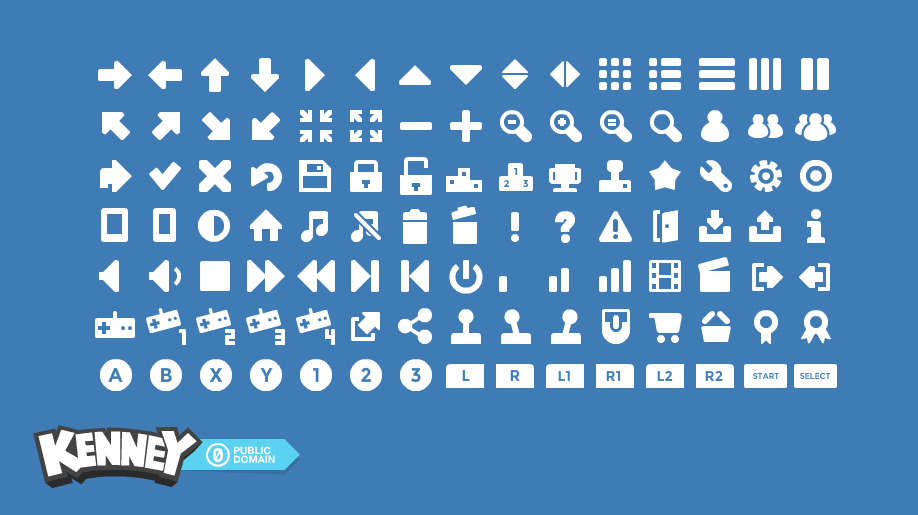
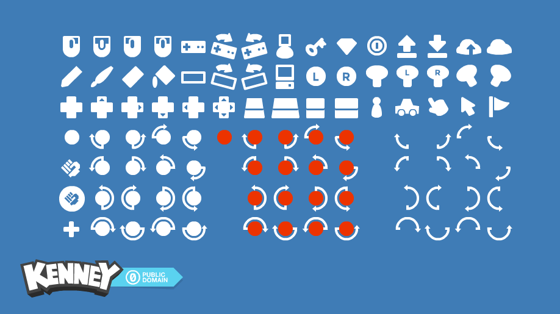
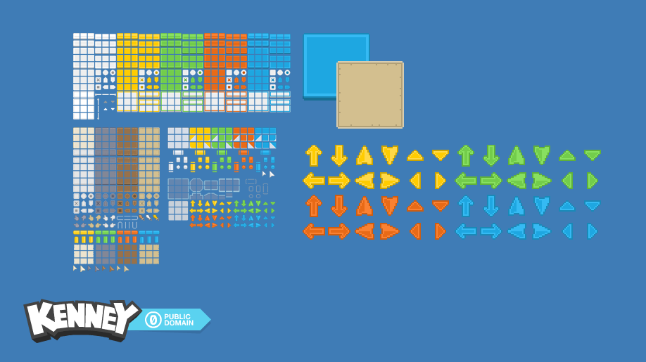
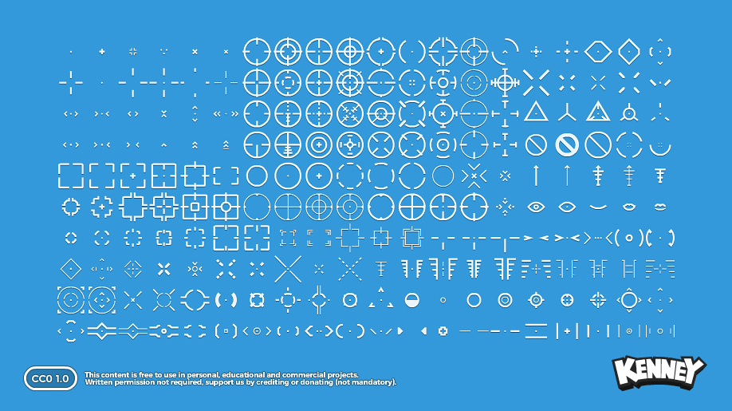

# assets-ui-icons

UI 키트와 아이콘. 장르를 가리지 않고 쓰이는 CC0 팩.

## 수록 팩

### Game Icons

- 파일: `gameicons.zip` (PNG 아이콘 425개 + SVG/AI 원본)
- 제작: Kenney / 라이선스: CC0 / 원본: https://kenney.nl/assets/game-icons

### Game Icons (Expansion)

- 파일: `gameicons-expansion.zip` (PNG 아이콘 790개 + SVG/AI 원본)
- 제작: Kenney / 라이선스: CC0 / 원본: https://kenney.nl/assets/game-icons-expansion

### Pixel UI Pack

- 파일: `pixeluipack.zip` (PNG 36개: 버튼·컨트롤·아이콘)
- 제작: Kenney / 라이선스: CC0 / 원본: https://kenney.nl/assets/pixel-ui-pack

### Crosshair Pack

- 파일: `crosshair-pack.zip` (크로스헤어 200종 × Black/White/Outline 3스타일, 일반+레티나(@2x) 해상도, 타일시트·SVG 원본 포함)
- 제작: Kenney / 라이선스: CC0 / 원본: https://kenney.nl/assets/crosshair-pack

## 사용 방법

1. 원하는 zip을 내려받아 프로젝트에 압축 해제 (Code 탭 → 파일 클릭 → Download)
2. CC0이므로 귀속 표기 없이 사용 가능 (표기 시 "Kenney (kenney.nl)")

## 출처와 라이선스 기록

- 원본 라이선스 전문: 각 zip 안에 제작자가 배포한 License.txt 원본이 그대로 보존되어 있습니다 (법적 효력은 이 원본 기준).
- 이 저장소 루트의 LICENSE.md는 원본을 대체하지 않는 수집자 요약본입니다.
- 원본 배포 페이지의 라이선스 조건(CC0)과 동봉된 License.txt를 확인했습니다.
- 파일 바이트는 Kenney 공식 미러 github.com/ETdoFresh/kenney.nl 에서 확보했으며, 공식 사이트 원본과 바이트 대조는 하지 않았습니다.

전체 인덱스와 장르 태그: [game-asset-catalog](https://github.com/sigco3111/game-asset-catalog)

## 2026-10-28 추가 팩 (릴리스 v2.0)

### Generic Items

- 파일: [릴리스 v2.0 첨부 다운로드](https://github.com/sigco3111/assets-ui-icons/releases/download/v2.0/generic-items.zip) (2.2MB, PNG 330개: 범용 아이템 아이콘)
- 제작: Kenney / 라이선스: CC0 / 원본: https://kenney.nl/assets/generic-items
### Emotes Pack

- 파일: [릴리스 v2.0 첨부 다운로드](https://github.com/sigco3111/assets-ui-icons/releases/download/v2.0/emotes-pack.zip) (0.4MB, PNG 513개: 감정 표현 이모트)
- 제작: Kenney / 라이선스: CC0 / 원본: https://kenney.nl/assets/emotes-pack

## 2026-10-28 추가 팩 (릴리스 v3.0)

### UI Pack

- 파일: [릴리스 v3.0 첨부 다운로드](https://github.com/sigco3111/assets-ui-icons/releases/download/v3.0/ui-pack.zip) (0.4MB, 파일 169개)
- 제작: Kenney / 라이선스: CC0 / 원본: https://kenney.nl/assets/ui-pack
### Ranks Pack

- 파일: [릴리스 v3.0 첨부 다운로드](https://github.com/sigco3111/assets-ui-icons/releases/download/v3.0/ranks-pack.zip) (0.7MB, 파일 644개)
- 제작: Kenney / 라이선스: CC0 / 원본: https://kenney.nl/assets/ranks-pack
### Cartography Pack

- 파일: [릴리스 v3.0 첨부 다운로드](https://github.com/sigco3111/assets-ui-icons/releases/download/v3.0/cartography-pack.zip) (4.2MB, 파일 182개)
- 제작: Kenney / 라이선스: CC0 / 원본: https://kenney.nl/assets/cartography-pack
### Rune Pack

- 파일: [릴리스 v3.0 첨부 다운로드](https://github.com/sigco3111/assets-ui-icons/releases/download/v3.0/rune-pack.zip) (2.2MB, 파일 693개)
- 제작: Kenney / 라이선스: CC0 / 원본: https://kenney.nl/assets/rune-pack
### Kenney Fonts

- 파일: [릴리스 v3.0 첨부 다운로드](https://github.com/sigco3111/assets-ui-icons/releases/download/v3.0/kenney-fonts.zip) (0.1MB, TTF 11종)
- 제작: Kenney / 라이선스: CC0 / 원본: https://kenney.nl/assets/kenney-fonts

## 2026-10-28 추가 팩 (릴리스 v4.0)

### Medals

- 파일: [릴리스 v4.0 첨부 다운로드](https://github.com/sigco3111/assets-ui-icons/releases/download/v4.0/medals.zip) (196K, 파일 34개)
- 제작: Kenney / 라이선스: CC0 / 원본: https://kenney.nl/assets/medals

## 2026-10-28 추가 확장: 실제 파일 검증

### Game-icons.net SVG Collection

- 다운로드: [game-icons-svg.zip](https://github.com/sigco3111/assets-ui-icons/releases/download/v5.0/game-icons-svg.zip)
- 실제 내용: SVG 4,180개, 모든 SVG 파싱 검사 완료. 미리보기는 60개 샘플입니다.
- 귀속 필수: Icons made by Lorc, Delapouite & contributors - https://game-icons.net/ - [CC BY 3.0](https://creativecommons.org/licenses/by/3.0/). 개별 아이콘 사용 시 해당 폴더의 제작자를 표시하고 수정 여부를 기록하세요. 원본 icons/license.txt에 제작자별 웹사이트가 있습니다. Viscious Speed·Zeromancer 폴더만 CC0입니다.
- 제작: Lorc, Delapouite & contributors / 라이선스: CC-BY-3.0 / CC0 (2 contributors) / 출처: https://game-icons.net/

이 확장의 원격 파일 SHA-256을 모두 로컬과 대조했습니다. 3D 팩의 모델 헤더·OBJ 정점/면, 오디오 디코딩, SVG 문서를 실제 파일에서 확인했습니다.
