# assets-ui-icons

UI 키트와 아이콘. 장르를 가리지 않고 쓰이는 CC0 팩.

## 수록 팩

### Game Icons
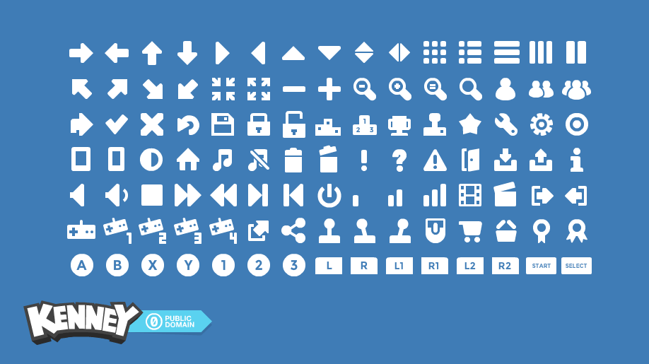
- 파일: `gameicons.zip` (PNG 아이콘 425개 + SVG/AI 원본)
- 제작: Kenney / 라이선스: CC0 / 원본: https://kenney.nl/assets/game-icons

### Game Icons (Expansion)
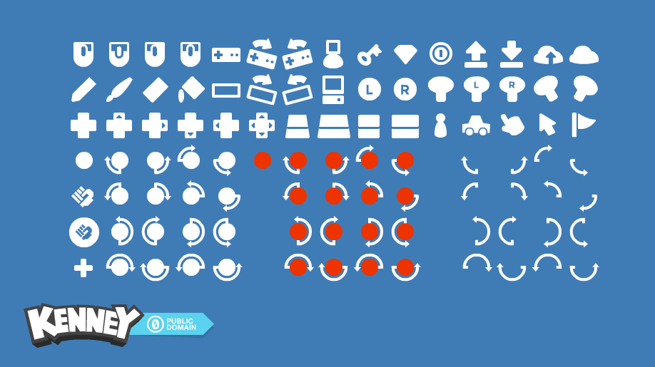
- 파일: `gameicons-expansion.zip` (PNG 아이콘 790개 + SVG/AI 원본)
- 제작: Kenney / 라이선스: CC0 / 원본: https://kenney.nl/assets/game-icons-expansion

### Pixel UI Pack
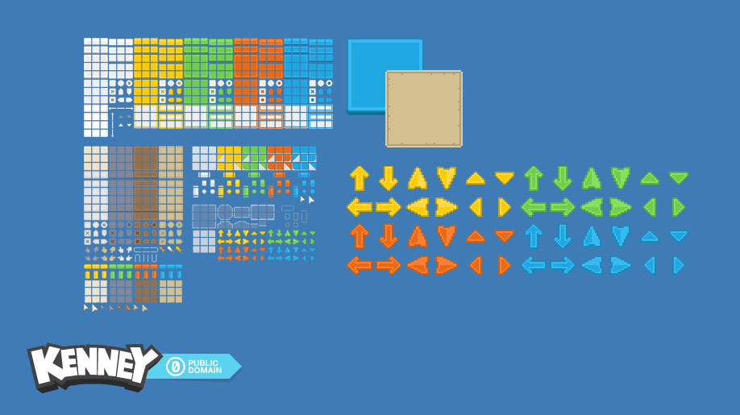
- 파일: `pixeluipack.zip` (PNG 36개: 버튼·컨트롤·아이콘)
- 제작: Kenney / 라이선스: CC0 / 원본: https://kenney.nl/assets/pixel-ui-pack

### Crosshair Pack
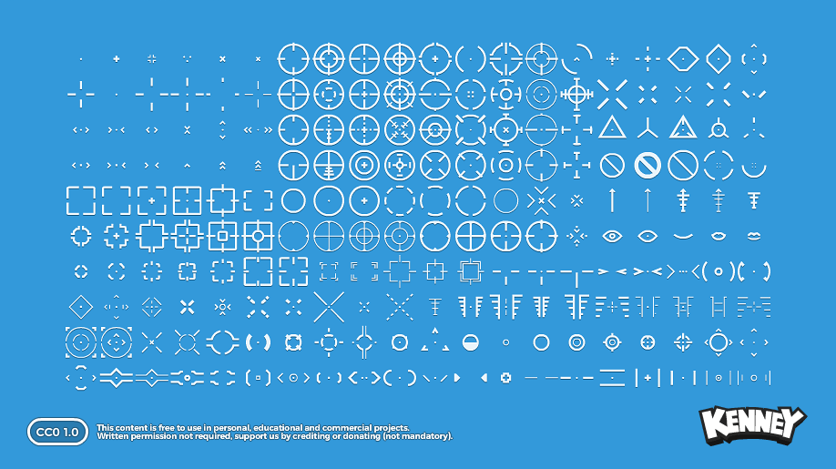
- 파일: `crosshair-pack.zip` (크로스헤어 200종 × Black/White/Outline 3스타일, 일반+레티나(@2x) 해상도, 타일시트·SVG 원본 포함)
- 제작: Kenney / 라이선스: CC0 / 원본: https://kenney.nl/assets/crosshair-pack

### UI Pack
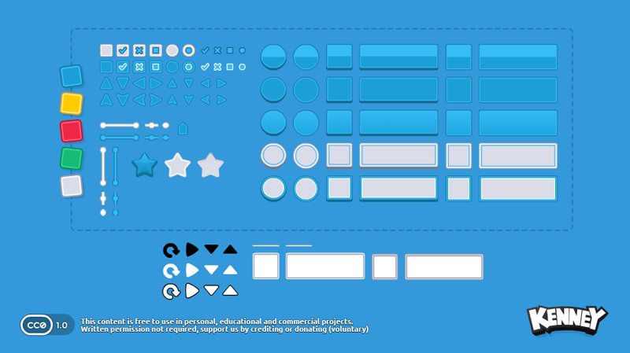
- 파일: [릴리스  첨부 다운로드](https://github.com/sigco3111/assets-ui-icons/releases/download//ui-pack.zip) (1.3MB, png 872개 · svg 434개 · ogg 6개 · txt 1개)
- 제작: Holofire / 라이선스: CC0 / 원본: https://opengameart.org/content/ui-pack

### Golden UI
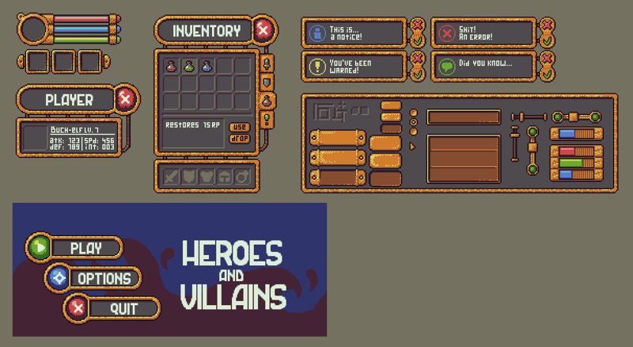
- 파일: [릴리스  첨부 다운로드](https://github.com/sigco3111/assets-ui-icons/releases/download//golden-ui.zip) (41KB, png 2개)
- 제작: Buch / 라이선스: CC0 / 원본: https://opengameart.org/content/golden-ui

### 496 pixel art icons for medieval/fantasy RPG
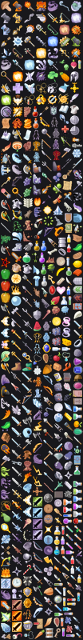
- 파일: [릴리스  첨부 다운로드](https://github.com/sigco3111/assets-ui-icons/releases/download//496-pixel-art-icons-for-medievalfantasy-rpg.zip) (1.8MB, png 497개)
- 제작: MedicineStorm / 라이선스: CC0 / 원본: https://opengameart.org/content/496-pixel-art-icons-for-medievalfantasy-rpg

### RPG Game UI
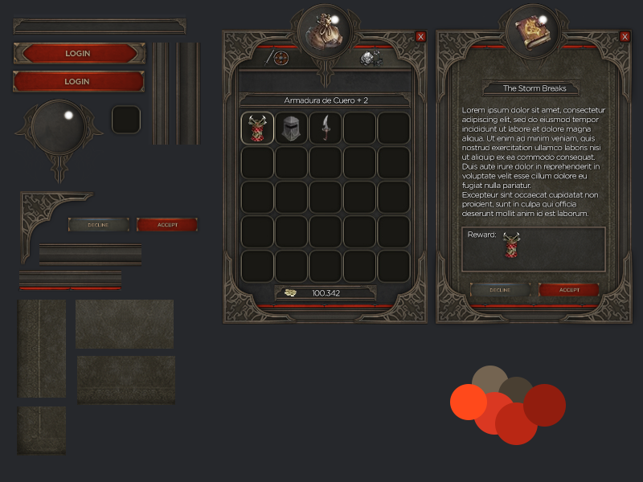
- 파일: [릴리스  첨부 다운로드](https://github.com/sigco3111/assets-ui-icons/releases/download//rpg-game-ui.zip) (396KB, png 1개)
- 제작: Chris_M_The_Gam... / 라이선스: CC0 / 원본: https://opengameart.org/content/rpg-game-ui

### GUI elements
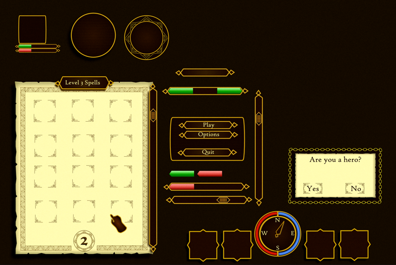
- 파일: [릴리스  첨부 다운로드](https://github.com/sigco3111/assets-ui-icons/releases/download//gui-elements.zip) (7.1MB, svg 4개 · png 4개)
- 제작: nazzyc / 라이선스: CC0 / 원본: https://opengameart.org/content/gui-elements

### UI pack: RPG extension
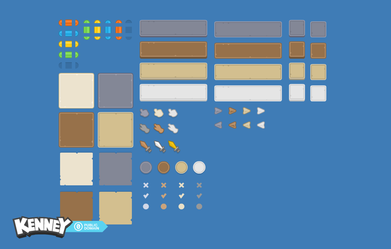
- 파일: [릴리스  첨부 다운로드](https://github.com/sigco3111/assets-ui-icons/releases/download//ui-pack-rpg-extension.zip) (312KB, png 92개 · txt 1개 · svg 1개)
- 제작: KumoKairo / 라이선스: CC0 / 원본: https://opengameart.org/content/ui-pack-rpg-extension

### UI Pack - Sci-Fi
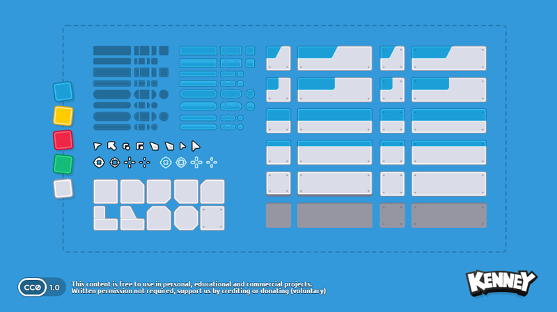
- 파일: [릴리스  첨부 다운로드](https://github.com/sigco3111/assets-ui-icons/releases/download//ui-pack-sci-fi.zip) (839KB, png 744개 · svg 370개 · txt 1개)
- 제작: TangZero / 라이선스: CC0 / 원본: https://opengameart.org/content/ui-pack-sci-fi

### Sci-fi User Interface Elements
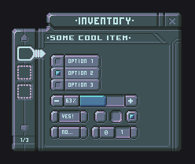
- 파일: [릴리스  첨부 다운로드](https://github.com/sigco3111/assets-ui-icons/releases/download//sci-fi-user-interface-elements.zip) (7KB, png 1개)
- 제작: PancInteractive / 라이선스: CC0 / 원본: https://opengameart.org/content/sci-fi-user-interface-elements

### Armor Icons by Equipment Slot
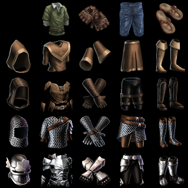
- 파일: [릴리스  첨부 다운로드](https://github.com/sigco3111/assets-ui-icons/releases/download//armor-icons-by-equipment-slot.zip) (222KB, png 2개)
- 제작: Acorn / 라이선스: CC0 / 원본: https://opengameart.org/content/armor-icons-by-equipment-slot

### UI pieces
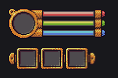
- 파일: [릴리스  첨부 다운로드](https://github.com/sigco3111/assets-ui-icons/releases/download//ui-pieces.zip) (16KB, png 3개)
- 제작: Tsukeo / 라이선스: CC0 / 원본: https://opengameart.org/content/ui-pieces

### FREE UI ASSET PACK 1
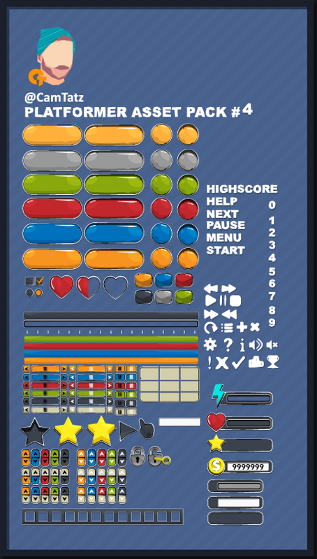
- 파일: [릴리스  첨부 다운로드](https://github.com/sigco3111/assets-ui-icons/releases/download//free-ui-asset-pack-1.zip) (1.3MB, png 190개 · txt 1개)
- 제작: warrior1988 / 라이선스: CC0 / 원본: https://opengameart.org/content/free-ui-asset-pack-1

### Skill, item and spell icons
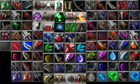
- 파일: [릴리스  첨부 다운로드](https://github.com/sigco3111/assets-ui-icons/releases/download//skill-item-and-spell-icons.zip) (25.4MB, png 105개 · txt 1개)
- 제작: qubodup / 라이선스: CC0 / 원본: https://opengameart.org/content/skill-item-and-spell-icons

### Pixel UI pack (750 assets)
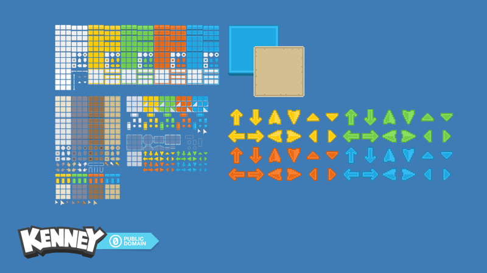
- 파일: [릴리스  첨부 다운로드](https://github.com/sigco3111/assets-ui-icons/releases/download//pixel-ui-pack-750-assets.zip) (232KB, png 37개 · txt 2개)
- 제작: patvanmackelberg / 라이선스: CC0 / 원본: https://opengameart.org/content/pixel-ui-pack-750-assets

### OSARE weapon icons
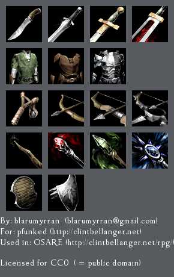
- 파일: [릴리스  첨부 다운로드](https://github.com/sigco3111/assets-ui-icons/releases/download//osare-weapon-icons.zip) (276KB, png 19개)
- 제작: Clint Bellanger / 라이선스: CC0 / 원본: https://opengameart.org/content/osare-weapon-icons

### Powers Icons
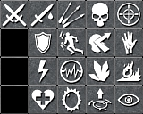
- 파일: [릴리스  첨부 다운로드](https://github.com/sigco3111/assets-ui-icons/releases/download//powers-icons.zip) (170KB, blend 1개 · png 1개 · jpg 1개)
- 제작: remaxim / 라이선스: CC0 / 원본: https://opengameart.org/content/powers-icons

### Gold treasure icons 16x16
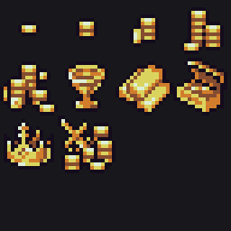
- 파일: [릴리스  첨부 다운로드](https://github.com/sigco3111/assets-ui-icons/releases/download//gold-treasure-icons-16x16.zip) (9KB, png 12개 · txt 1개)
- 제작: Clint Bellanger / 라이선스: CC0 / 원본: https://opengameart.org/content/gold-treasure-icons-16x16

### Game icons

- 파일: [릴리스  첨부 다운로드](https://github.com/sigco3111/assets-ui-icons/releases/download//game-icons.zip) (1.1MB, png 426개 · svg 2개 · txt 1개)
- 제작: Calinou / 라이선스: CC0 / 원본: https://opengameart.org/content/game-icons

### Game icons (expansion)

- 파일: [릴리스  첨부 다운로드](https://github.com/sigco3111/assets-ui-icons/releases/download//game-icons-expansion.zip) (2.1MB, png 791개 · svg 4개 · txt 2개)
- 제작: monsterkillu / 라이선스: CC0 / 원본: https://opengameart.org/content/game-icons-expansion

### New original Grafx2 font collection
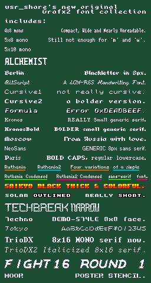
- 파일: [릴리스  첨부 다운로드](https://github.com/sigco3111/assets-ui-icons/releases/download//new-original-grafx2-font-collection.zip) (52KB, png 27개)
- 제작: canisferus / 라이선스: CC0 / 원본: https://opengameart.org/content/new-original-grafx2-font-collection

### Medieval Game Button Pack
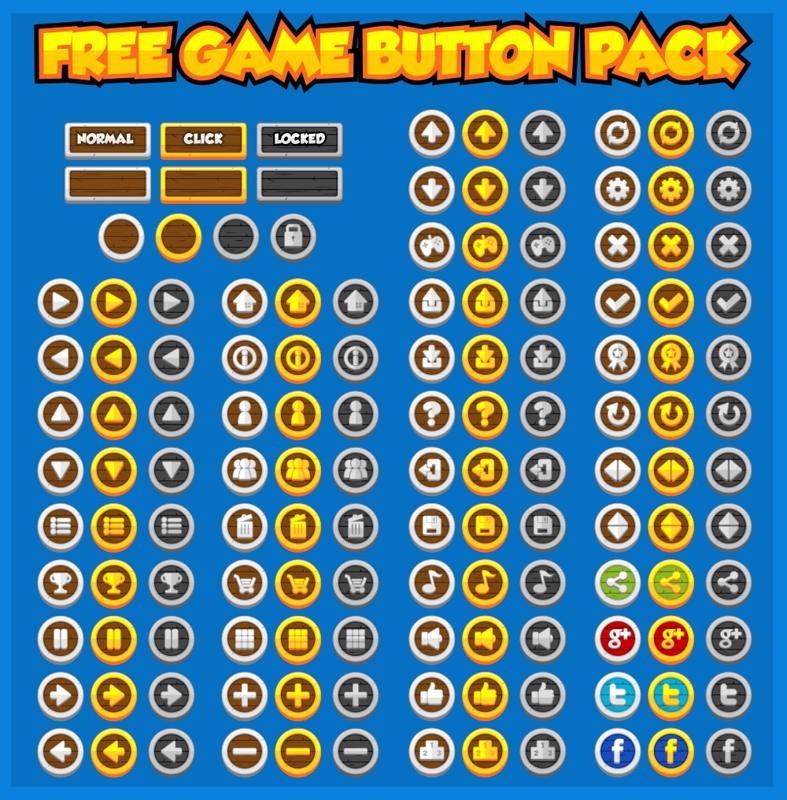
- 파일: [릴리스  첨부 다운로드](https://github.com/sigco3111/assets-ui-icons/releases/download//medieval-game-button-pack.zip) (5.6MB, png 1개 · svg 1개 · jpg 1개)
- 제작: Grygier / 라이선스: CC0 / 원본: https://opengameart.org/content/medieval-game-button-pack

### The collection of 8-bit fonts for Grafx2 (r2)
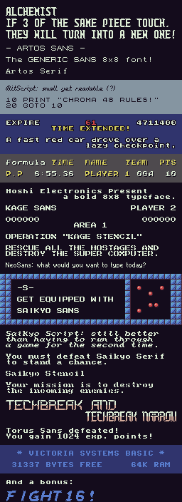
- 파일: [릴리스  첨부 다운로드](https://github.com/sigco3111/assets-ui-icons/releases/download//the-collection-of-8-bit-fonts-for-grafx2-r2.zip) (43KB, png 20개)
- 제작: cemkalyoncu / 라이선스: CC0 / 원본: https://opengameart.org/content/the-collection-of-8-bit-fonts-for-grafx2-r2

### Free Game GUI
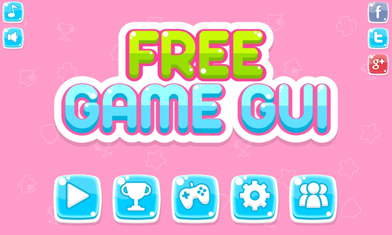
- 파일: [릴리스  첨부 다운로드](https://github.com/sigco3111/assets-ui-icons/releases/download//free-game-gui.zip) (20.2MB, jpg 3개 · svg 3개 · png 3개 · txt 1개)
- 제작: Aetherna / 라이선스: CC0 / 원본: https://opengameart.org/content/free-game-gui

### CC0 Food Icons
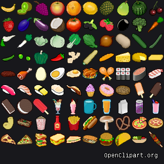
- 파일: [릴리스  첨부 다운로드](https://github.com/sigco3111/assets-ui-icons/releases/download//cc0-food-icons.zip) (7.9MB, png 1221개 · svg 357개 · txt 13개)
- 제작: bluecarrot16 / 라이선스: CC0 / 원본: https://opengameart.org/content/cc0-food-icons

### Flare buttons
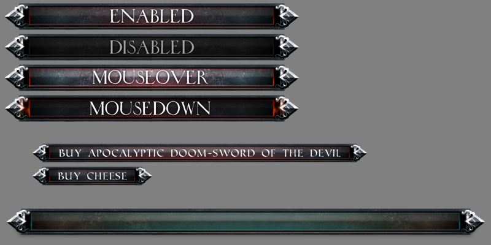
- 파일: [릴리스  첨부 다운로드](https://github.com/sigco3111/assets-ui-icons/releases/download//flare-buttons.zip) (916KB, png 3개)
- 제작: bart / 라이선스: CC0 / 원본: https://opengameart.org/content/flare-buttons

### UI resources
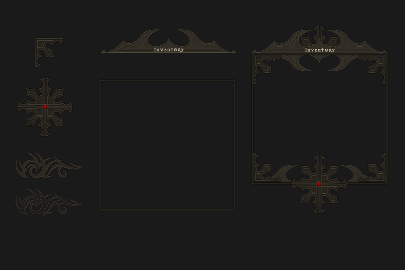
- 파일: [릴리스  첨부 다운로드](https://github.com/sigco3111/assets-ui-icons/releases/download//ui-resources.zip) (113KB, jpg 1개)
- 제작: greyK / 라이선스: CC0 / 원본: https://opengameart.org/content/ui-resources

### Sci-fi User Interface
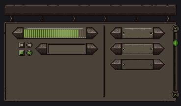
- 파일: [릴리스  첨부 다운로드](https://github.com/sigco3111/assets-ui-icons/releases/download//sci-fi-user-interface.zip) (42KB, png 4개)
- 제작: yd / 라이선스: CC0 / 원본: https://opengameart.org/content/sci-fi-user-interface

### Shiny hud
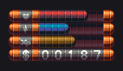
- 파일: [릴리스  첨부 다운로드](https://github.com/sigco3111/assets-ui-icons/releases/download//shiny-hud.zip) (21KB, png 3개)
- 제작: Danimal / 라이선스: CC0 / 원본: https://opengameart.org/content/shiny-hud

### Armor Icons by Equipment slot with transparency
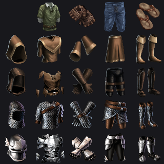
- 파일: [릴리스  첨부 다운로드](https://github.com/sigco3111/assets-ui-icons/releases/download//armor-icons-by-equipment-slot-with-transparency.zip) (467KB, png 3개)
- 제작: Bonsaiheldin / 라이선스: CC0 / 원본: https://opengameart.org/content/armor-icons-by-equipment-slot-with-transparency

### Good Neighbors pixel font
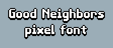
- 파일: [릴리스  첨부 다운로드](https://github.com/sigco3111/assets-ui-icons/releases/download//good-neighbors-pixel-font.zip) (34KB, png 4개)
- 제작: dannorder / 라이선스: CC0 / 원본: https://opengameart.org/content/good-neighbors-pixel-font

### UI Button
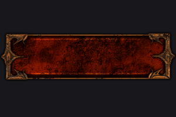
- 파일: [릴리스  첨부 다운로드](https://github.com/sigco3111/assets-ui-icons/releases/download//ui-button.zip) (268KB, png 6개)
- 제작: Dread Knight / 라이선스: CC0 / 원본: https://opengameart.org/content/ui-button

### Fantasy UI Box
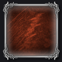
- 파일: [릴리스  첨부 다운로드](https://github.com/sigco3111/assets-ui-icons/releases/download//fantasy-ui-box.zip) (654KB, png 3개)
- 제작: sandsound / 라이선스: CC0 / 원본: https://opengameart.org/content/fantasy-ui-box

### UI Elements
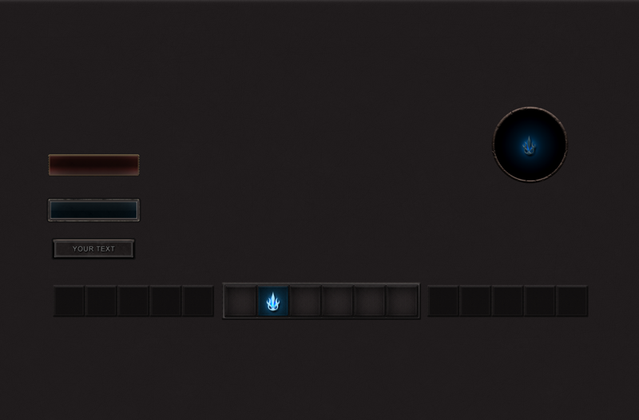
- 파일: [릴리스  첨부 다운로드](https://github.com/sigco3111/assets-ui-icons/releases/download//ui-elements-0.zip) (13.3MB, png 1개)
- 제작: JaidynReiman / 라이선스: CC0 / 원본: https://opengameart.org/content/ui-elements-0

### FPS UI MISC Pack 1 [CTATZ]
![FPS UI MISC Pack 1 [CTATZ] 미리보기](previews/fps-ui-misc-pack-1-ctatz.png)
- 파일: [릴리스  첨부 다운로드](https://github.com/sigco3111/assets-ui-icons/releases/download//fps-ui-misc-pack-1-ctatz.zip) (657KB, png 110개 · txt 1개)
- 제작: KumoKairo / 라이선스: CC0 / 원본: https://opengameart.org/content/fps-ui-misc-pack-1-ctatz

### Modified And Cliped Magic, Skill & Item Icons
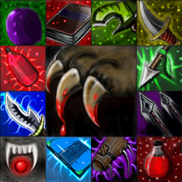
- 파일: [릴리스  첨부 다운로드](https://github.com/sigco3111/assets-ui-icons/releases/download//modified-and-cliped-magic-skill-item-icons.zip) (90.2MB, png 583개 · jpg 1개)
- 제작: Pompei2 / 라이선스: CC0 / 원본: https://opengameart.org/content/modified-and-cliped-magic-skill-item-icons

### Boxy Bold Font
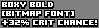
- 파일: [릴리스  첨부 다운로드](https://github.com/sigco3111/assets-ui-icons/releases/download//boxy-bold-font.zip) (4KB, png 3개)
- 제작: Eiyeron / 라이선스: CC0 / 원본: https://opengameart.org/content/boxy-bold-font

### Three Little Bitmap Fonts
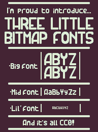
- 파일: [릴리스  첨부 다운로드](https://github.com/sigco3111/assets-ui-icons/releases/download//three-little-bitmap-fonts.zip) (23KB, png 3개)
- 제작: Hercules / 라이선스: CC0 / 원본: https://opengameart.org/content/three-little-bitmap-fonts

### 16x16 Assorted RPG Icons
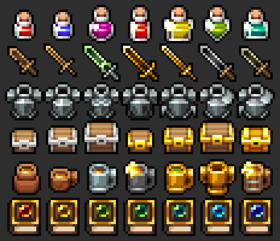
- 파일: [릴리스  첨부 다운로드](https://github.com/sigco3111/assets-ui-icons/releases/download//16x16-assorted-rpg-icons.zip) (396KB, png 13개)
- 제작: tbbk / 라이선스: CC0 / 원본: https://opengameart.org/content/16x16-assorted-rpg-icons

### A package of 8-bit fonts for Grafx2 and Linux
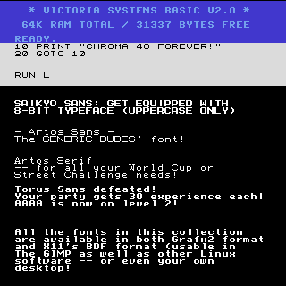
- 파일: [릴리스  첨부 다운로드](https://github.com/sigco3111/assets-ui-icons/releases/download//a-package-of-8-bit-fonts-for-grafx2-and-linux.zip) (32KB, png 7개)
- 제작: bitcraft / 라이선스: CC0 / 원본: https://opengameart.org/content/a-package-of-8-bit-fonts-for-grafx2-and-linux

### Free Fantasy Game GUI

- 파일: [릴리스  첨부 다운로드](https://github.com/sigco3111/assets-ui-icons/releases/download//free-fantasy-game-gui.zip) (10.8MB, jpg 3개 · svg 2개 · png 2개 · txt 1개)
- 제작: Snabisch / 라이선스: CC0 / 원본: https://opengameart.org/content/free-fantasy-game-gui

### match 3 gui
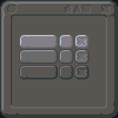
- 파일: [릴리스  첨부 다운로드](https://github.com/sigco3111/assets-ui-icons/releases/download//match-3-gui.zip) (14KB, png 5개)
- 제작: Buch / 라이선스: CC0 / 원본: https://opengameart.org/content/match-3-gui

### RPG User Interface
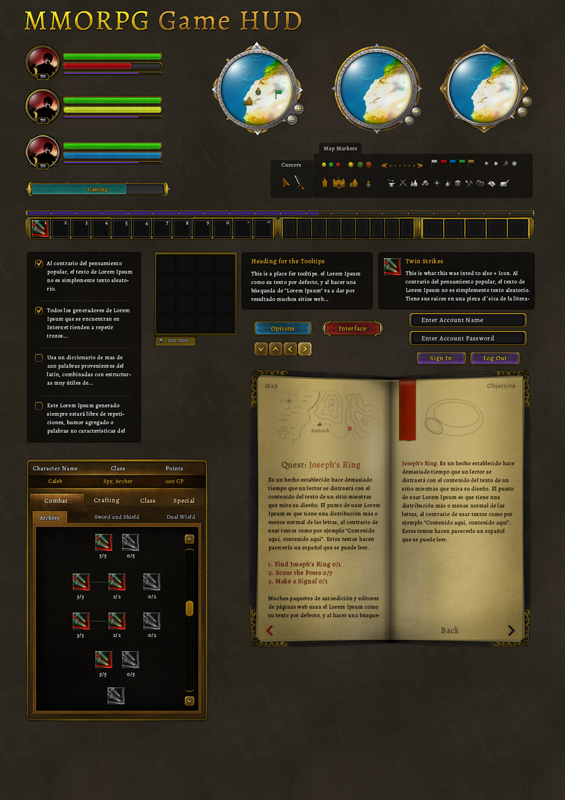
- 파일: [릴리스  첨부 다운로드](https://github.com/sigco3111/assets-ui-icons/releases/download//rpg-user-interface.zip) (24.6MB, jpg 1개 · txt 1개)
- 제작: 불명 (OGA 계정 삭제됨) / 라이선스: CC0 / 원본: https://opengameart.org/content/rpg-user-interface

### Casual Game Button Pack
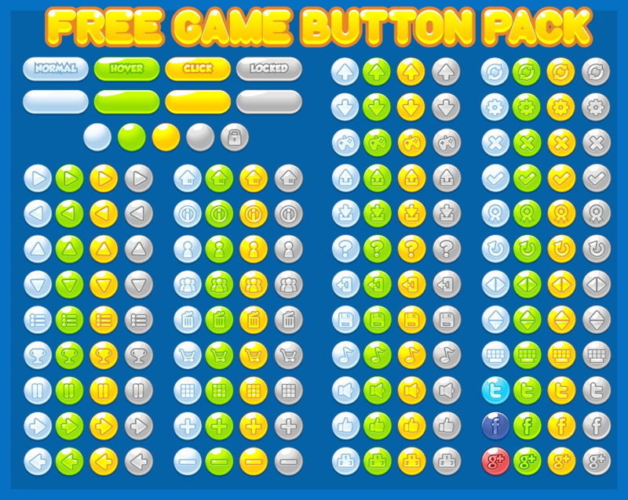
- 파일: [릴리스  첨부 다운로드](https://github.com/sigco3111/assets-ui-icons/releases/download//casual-game-button-pack.zip) (9.6MB, svg 1개 · png 1개 · jpg 1개)
- 제작: Calinou / 라이선스: CC0 / 원본: https://opengameart.org/content/casual-game-button-pack

### RPG UI Icons
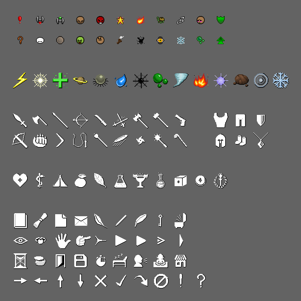
- 파일: [릴리스  첨부 다운로드](https://github.com/sigco3111/assets-ui-icons/releases/download//rpg-ui-icons.zip) (76KB, png 109개)
- 제작: NaranjaIncógnita / 라이선스: CC0 / 원본: https://opengameart.org/content/rpg-ui-icons

### FANTASY GUI
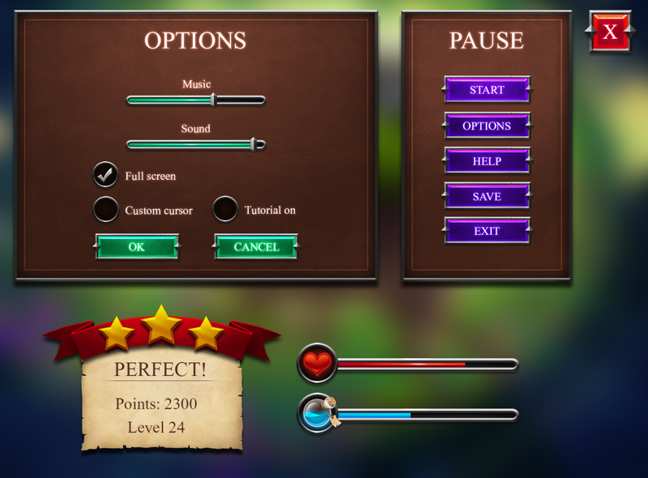
- 파일: [릴리스  첨부 다운로드](https://github.com/sigco3111/assets-ui-icons/releases/download//fantasy-gui-0.zip) (5.6MB, png 5개)
- 제작: Dread Knight / 라이선스: CC0 / 원본: https://opengameart.org/content/fantasy-gui-0

### New Blue Gui
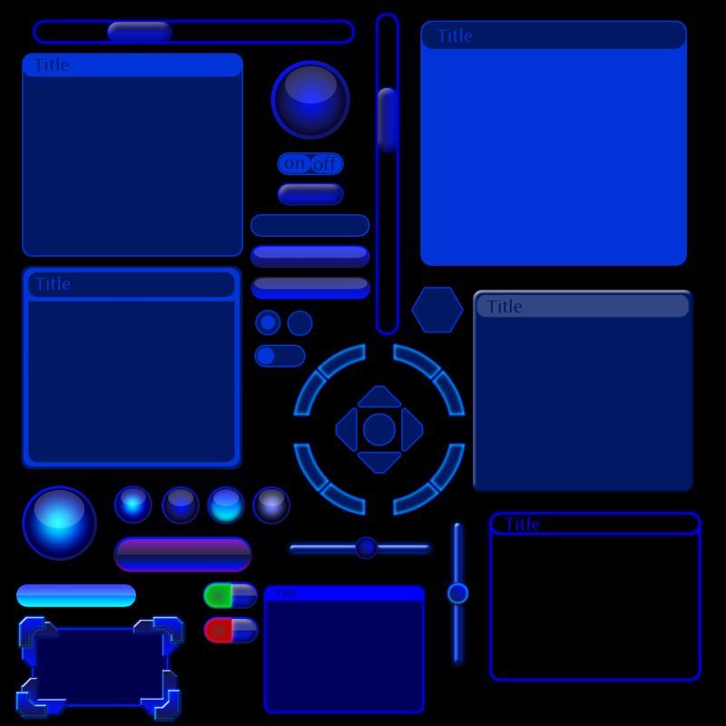
- 파일: [릴리스  첨부 다운로드](https://github.com/sigco3111/assets-ui-icons/releases/download//new-blue-gui.zip) (344KB, png 1개 · jpg 1개)
- 제작: smoke_th / 라이선스: CC0 / 원본: https://opengameart.org/content/new-blue-gui

### UI Pack Expansion

- 파일: [릴리스  첨부 다운로드](https://github.com/sigco3111/assets-ui-icons/releases/download//ui-pack-expansion.zip) (49KB, png 1개 · svg 1개)
- 제작: russpuppy / 라이선스: CC0 / 원본: https://opengameart.org/content/ui-pack-expansion

### Tango Desktop Icons
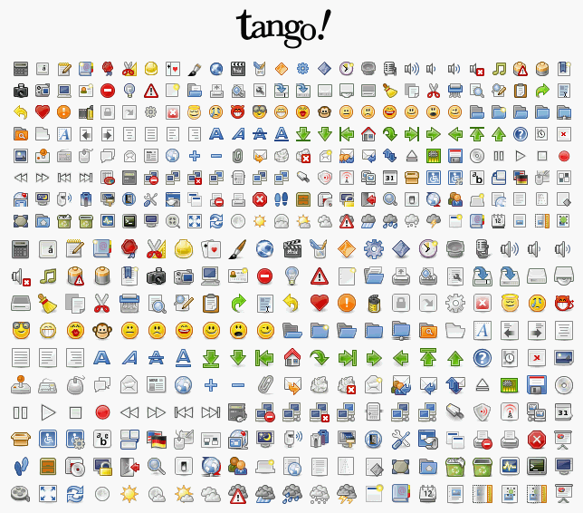
- 파일: [릴리스  첨부 다운로드](https://github.com/sigco3111/assets-ui-icons/releases/download//tango-desktop-icons.zip) (339KB, png 1개)
- 제작: ? / 라이선스: CC0 / 원본: https://opengameart.org/content/tango-desktop-icons

### Free Bubble Game Button Pack
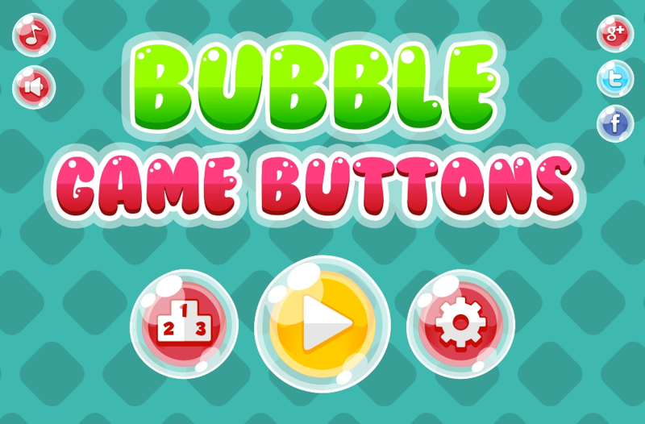
- 파일: [릴리스  첨부 다운로드](https://github.com/sigco3111/assets-ui-icons/releases/download//free-bubble-game-button-pack.zip) (10.8MB, jpg 2개 · txt 1개 · png 1개 · svg 1개)
- 제작: looneybits / 라이선스: CC0 / 원본: https://opengameart.org/content/free-bubble-game-button-pack

### Superpowers assets bitmap fonts
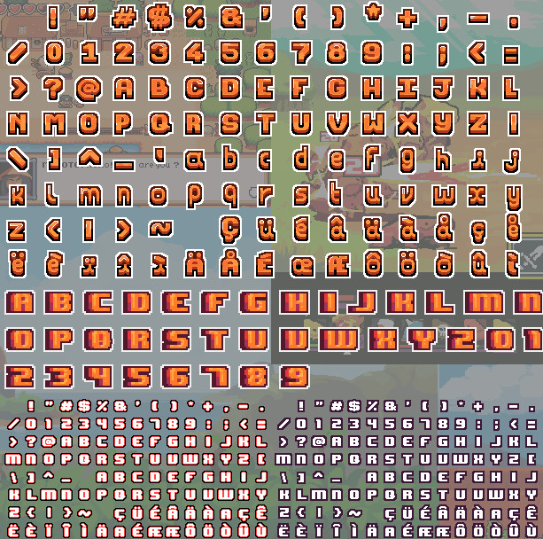
- 파일: [릴리스  첨부 다운로드](https://github.com/sigco3111/assets-ui-icons/releases/download//superpowers-assets-bitmap-fonts.zip) (615KB, png 16개 · jpg 3개 · txt 2개)
- 제작: Snabisch / 라이선스: CC0 / 원본: https://opengameart.org/content/superpowers-assets-bitmap-fonts

### Mouse buttons & arrow keys
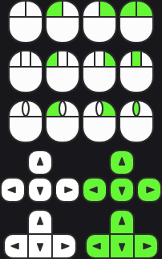
- 파일: [릴리스  첨부 다운로드](https://github.com/sigco3111/assets-ui-icons/releases/download//mouse-buttons-arrow-keys.zip) (17KB, png 1개 · svg 1개)
- 제작: metaldev / 라이선스: CC0 / 원본: https://opengameart.org/content/mouse-buttons-arrow-keys

### Bitmap font
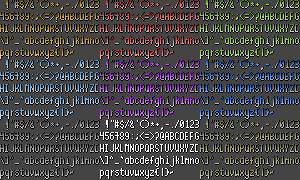
- 파일: [릴리스  첨부 다운로드](https://github.com/sigco3111/assets-ui-icons/releases/download//bitmap-font-0.zip) (152KB, png 12개)
- 제작: CelestialCreator / 라이선스: CC0 / 원본: https://opengameart.org/content/bitmap-font-0

### Cartoon Mobile Rounded Icon Buttons

- 파일: [릴리스  첨부 다운로드](https://github.com/sigco3111/assets-ui-icons/releases/download//cartoon-mobile-rounded-icon-buttons.zip) (2.8MB, png 570개 · jpg 1개)
- 제작: monsterkillu / 라이선스: CC0 / 원본: https://opengameart.org/content/cartoon-mobile-rounded-icon-buttons

### 16x16 Weapon RPG Icons

- 파일: [릴리스  첨부 다운로드](https://github.com/sigco3111/assets-ui-icons/releases/download//16x16-weapon-rpg-icons.zip) (760KB, png 18개)
- 제작: FiveBrosStopMosYT / 라이선스: CC0 / 원본: https://opengameart.org/content/16x16-weapon-rpg-icons

### High-Tech UI

- 파일: [릴리스  첨부 다운로드](https://github.com/sigco3111/assets-ui-icons/releases/download//high-tech-ui.zip) (16.2MB, jpg 1개 · txt 1개)
- 제작: iPoly3D / 라이선스: CC0 / 원본: https://opengameart.org/content/high-tech-ui

### Flare weapon icons 2

- 파일: [릴리스  첨부 다운로드](https://github.com/sigco3111/assets-ui-icons/releases/download//flare-weapon-icons-2.zip) (948KB, png 12개 · txt 1개)
- 제작: davidbv / 라이선스: CC0 / 원본: https://opengameart.org/content/flare-weapon-icons-2

### Inventory GUI

- 파일: [릴리스  첨부 다운로드](https://github.com/sigco3111/assets-ui-icons/releases/download//inventory-gui.zip) (375KB, jpg 1개)
- 제작: FacadeGaikan / 라이선스: CC0 / 원본: https://opengameart.org/content/inventory-gui

### Flare HUD

- 파일: [릴리스  첨부 다운로드](https://github.com/sigco3111/assets-ui-icons/releases/download//flare-hud.zip) (51KB, png 15개)
- 제작: Clint Bellanger / 라이선스: CC0 / 원본: https://opengameart.org/content/flare-hud

### Concrete UI, part 2

- 파일: [릴리스  첨부 다운로드](https://github.com/sigco3111/assets-ui-icons/releases/download//concrete-ui-part-2.zip) (30KB, png 2개)
- 제작: dalonedrau / 라이선스: CC0 / 원본: https://opengameart.org/content/concrete-ui-part-2

### Boxy Bold Font+

- 파일: [릴리스  첨부 다운로드](https://github.com/sigco3111/assets-ui-icons/releases/download//boxy-bold-font-0.zip) (2KB, png 1개)
- 제작: Clint Bellanger / 라이선스: CC0 / 원본: https://opengameart.org/content/boxy-bold-font-0

### Brightmix Icon Set

- 파일: [릴리스  첨부 다운로드](https://github.com/sigco3111/assets-ui-icons/releases/download//brightmix-icon-set.zip) (617KB, png 3개 · svg 1개)
- 제작: Anonymous (not verified) / 라이선스: CC0 / 원본: https://opengameart.org/content/brightmix-icon-set

### Game icons (fighter expansion)

- 파일: [릴리스  첨부 다운로드](https://github.com/sigco3111/assets-ui-icons/releases/download//game-icons-fighter-expansion.zip) (2.5MB, png 952개 · svg 6개 · txt 3개)
- 제작: Nekohime / 라이선스: CC0 / 원본: https://opengameart.org/content/game-icons-fighter-expansion

### UI Orbs

- 파일: [릴리스  첨부 다운로드](https://github.com/sigco3111/assets-ui-icons/releases/download//ui-orbs.zip) (340KB, png 8개)
- 제작: Onyx Melon / 라이선스: CC0 / 원본: https://opengameart.org/content/ui-orbs

### Assets: UI Different Free #2 [Icons, Bars, Buttons]
![Assets: UI Different Free #2 [Icons, Bars, Buttons] 미리보기](previews/assets-ui-different-free-2-icons-bars-buttons.png)
- 파일: [릴리스  첨부 다운로드](https://github.com/sigco3111/assets-ui-icons/releases/download//assets-ui-different-free-2-icons-bars-buttons.zip) (4.1MB, png 74개 · jpg 9개)
- 제작: Bonsaiheldin / 라이선스: CC0 / 원본: https://opengameart.org/content/assets-ui-different-free-2-icons-bars-buttons

### Gauntlet Cursor

- 파일: [릴리스  첨부 다운로드](https://github.com/sigco3111/assets-ui-icons/releases/download//gauntlet-cursor.zip) (120KB, png 9개 · jpg 3개)
- 제작: Snabisch / 라이선스: CC0 / 원본: https://opengameart.org/content/gauntlet-cursor

### Game Button Pack

- 파일: [릴리스  첨부 다운로드](https://github.com/sigco3111/assets-ui-icons/releases/download//game-button-pack.zip) (4.9MB, png 1개 · svg 1개 · jpg 1개)
- 제작: ErLuiSSJL / 라이선스: CC0 / 원본: https://opengameart.org/content/game-button-pack

### Control Icons

- 파일: [릴리스  첨부 다운로드](https://github.com/sigco3111/assets-ui-icons/releases/download//control-icons.zip) (10KB, png 2개 · txt 1개)
- 제작: SquareFox / 라이선스: CC0 / 원본: https://opengameart.org/content/control-icons

### RetroPixel Icons V1 (9x9)

- 파일: [릴리스  첨부 다운로드](https://github.com/sigco3111/assets-ui-icons/releases/download//retropixel-icons-v1-9x9.zip) (208KB, png 66개)
- 제작: Snabisch / 라이선스: CC0 / 원본: https://opengameart.org/content/retropixel-icons-v1-9x9

### RPG Icons

- 파일: [릴리스  첨부 다운로드](https://github.com/sigco3111/assets-ui-icons/releases/download//rpg-icons-3.zip) (2.8MB, png 120개 · txt 1개)
- 제작: MedicineStorm / 라이선스: CC0 / 원본: https://opengameart.org/content/rpg-icons-3

### Simple Pixel GUI (Programmer Art)

- 파일: [릴리스  첨부 다운로드](https://github.com/sigco3111/assets-ui-icons/releases/download//simple-pixel-gui-programmer-art.zip) (60KB, png 2개)
- 제작: Snabisch / 라이선스: CC0 / 원본: https://opengameart.org/content/simple-pixel-gui-programmer-art

### GUI Windows constructor

- 파일: [릴리스  첨부 다운로드](https://github.com/sigco3111/assets-ui-icons/releases/download//gui-windows-constructor.zip) (72KB, png 2개)
- 제작: Esanay / 라이선스: CC0 / 원본: https://opengameart.org/content/gui-windows-constructor

### Space icons with base, defensive guns, ships & scenery

- 파일: [릴리스  첨부 다운로드](https://github.com/sigco3111/assets-ui-icons/releases/download//space-icons-with-base-defensive-guns-ships-scenery.zip) (35KB, png 2개)
- 제작: Snabisch / 라이선스: CC0 / 원본: https://opengameart.org/content/space-icons-with-base-defensive-guns-ships-scenery

### Turning Polyhedron GUI

- 파일: [릴리스  첨부 다운로드](https://github.com/sigco3111/assets-ui-icons/releases/download//turning-polyhedron-gui.zip) (100KB, png 2개)
- 제작: ILIKESCIFI / 라이선스: CC0 / 원본: https://opengameart.org/content/turning-polyhedron-gui

### Mobile Game GUI Buttons

- 파일: [릴리스  첨부 다운로드](https://github.com/sigco3111/assets-ui-icons/releases/download//mobile-game-gui-buttons.zip) (2.5MB, png 5개 · txt 2개)
- 제작: ilan / 라이선스: CC0 / 원본: https://opengameart.org/content/mobile-game-gui-buttons

### Simple hud gui constraction kit in 8 colors

- 파일: [릴리스  첨부 다운로드](https://github.com/sigco3111/assets-ui-icons/releases/download//simple-hud-gui-constraction-kit-in-8-colors.zip) (1.8MB, png 224개 · jpg 2개)
- 제작: PancInteractive / 라이선스: CC0 / 원본: https://opengameart.org/content/simple-hud-gui-constraction-kit-in-8-colors

### Aleona's Tales: some UI

- 파일: [릴리스  첨부 다운로드](https://github.com/sigco3111/assets-ui-icons/releases/download//aleonas-tales-some-ui.zip) (4.1MB, png 2개)
- 제작: qubodup / 라이선스: CC0 / 원본: https://opengameart.org/content/aleonas-tales-some-ui

### Space Gui in various colors

- 파일: [릴리스  첨부 다운로드](https://github.com/sigco3111/assets-ui-icons/releases/download//space-gui-in-various-colors.zip) (13.2MB, png 33개)
- 제작: SmokeHouseGames / 라이선스: CC0 / 원본: https://opengameart.org/content/space-gui-in-various-colors

### GUI Buttons Vol.1

- 파일: [릴리스  첨부 다운로드](https://github.com/sigco3111/assets-ui-icons/releases/download//gui-buttons-vol1.zip) (1.5MB, png 192개 · txt 1개 · svg 1개)
- 제작: Snabisch / 라이선스: CC0 / 원본: https://opengameart.org/content/gui-buttons-vol1

### Tiny RPG - Dragon Regalia GUI

- 파일: [릴리스  첨부 다운로드](https://github.com/sigco3111/assets-ui-icons/releases/download//tiny-rpg-dragon-regalia-gui.zip) (179KB, png 50개)
- 제작: MedicineStorm / 라이선스: CC0 / 원본: https://opengameart.org/content/tiny-rpg-dragon-regalia-gui

### Board Game Icons

- 파일: [릴리스  첨부 다운로드](https://github.com/sigco3111/assets-ui-icons/releases/download//board-game-icons.zip) (1.2MB, png 514개 · svg 256개 · txt 2개)
- 제작: ? / 라이선스: CC0 / 원본: https://opengameart.org/content/board-game-icons

### Minmal GUI

- 파일: [릴리스  첨부 다운로드](https://github.com/sigco3111/assets-ui-icons/releases/download//minmal-gui.zip) (10KB, png 3개)
- 제작: vk / 라이선스: CC0 / 원본: https://opengameart.org/content/minmal-gui

### Button Prompts for Pixel/Low Res UIs

- 파일: [릴리스  첨부 다운로드](https://github.com/sigco3111/assets-ui-icons/releases/download//button-prompts-for-pixellow-res-uis.zip) (14KB, png 2개)
- 제작: withthelove / 라이선스: CC0 / 원본: https://opengameart.org/content/button-prompts-for-pixellow-res-uis

### 36 free black and white icons

- 파일: [릴리스  첨부 다운로드](https://github.com/sigco3111/assets-ui-icons/releases/download//36-free-black-and-white-icons.zip) (857KB, png 37개)
- 제작: vk / 라이선스: CC0 / 원본: https://opengameart.org/content/36-free-black-and-white-icons

### UI Set - 1

- 파일: [릴리스  첨부 다운로드](https://github.com/sigco3111/assets-ui-icons/releases/download//ui-set-1.zip) (439KB, png 65개)
- 제작: Snabisch / 라이선스: CC0 / 원본: https://opengameart.org/content/ui-set-1

### Bitmap Font

- 파일: [릴리스  첨부 다운로드](https://github.com/sigco3111/assets-ui-icons/releases/download//bitmap-font.zip) (6KB, png 2개 · txt 1개)
- 제작: Clint Bellanger / 라이선스: CC0 / 원본: https://opengameart.org/content/bitmap-font

### Icons: Food.

- 파일: [릴리스  첨부 다운로드](https://github.com/sigco3111/assets-ui-icons/releases/download//icons-food.zip) (13KB, png 2개)
- 제작: pechvogel / 라이선스: CC0 / 원본: https://opengameart.org/content/icons-food

### Fantasy UI Borders

- 파일: [릴리스  첨부 다운로드](https://github.com/sigco3111/assets-ui-icons/releases/download//fantasy-ui-borders.zip) (605KB, png 284개 · txt 1개 · svg 1개)
- 제작: knekko / 라이선스: CC0 / 원본: https://opengameart.org/content/fantasy-ui-borders

### Main Menu Panel

- 파일: [릴리스  첨부 다운로드](https://github.com/sigco3111/assets-ui-icons/releases/download//main-menu-panel.zip) (260KB, png 1개)
- 제작: ? / 라이선스: CC0 / 원본: https://opengameart.org/content/main-menu-panel

### RPG UI

- 파일: [릴리스  첨부 다운로드](https://github.com/sigco3111/assets-ui-icons/releases/download//rpg-ui-1.zip) (10.4MB, png 21개 · txt 1개)
- 제작: antikx / 라이선스: CC0 / 원본: https://opengameart.org/content/rpg-ui-1

### Mini Icons

- 파일: [릴리스  첨부 다운로드](https://github.com/sigco3111/assets-ui-icons/releases/download//mini-icons.zip) (130KB, png 1개 · txt 1개)
- 제작: IceGames / 라이선스: CC0 / 원본: https://opengameart.org/content/mini-icons

### Simple RPG GUI

- 파일: [릴리스  첨부 다운로드](https://github.com/sigco3111/assets-ui-icons/releases/download//simple-rpg-gui.zip) (34KB, png 1개)
- 제작: TheWaffle / 라이선스: CC0 / 원본: https://opengameart.org/content/simple-rpg-gui

### Free UI Hologram Interface

- 파일: [릴리스  첨부 다운로드](https://github.com/sigco3111/assets-ui-icons/releases/download//free-ui-hologram-interface.zip) (1.9MB, png 48개 · jpg 3개 · txt 1개)
- 제작: flamming / 라이선스: CC0 / 원본: https://opengameart.org/content/free-ui-hologram-interface

### Tiny gun icons (16x16)

- 파일: [릴리스  첨부 다운로드](https://github.com/sigco3111/assets-ui-icons/releases/download//tiny-gun-icons-16x16.zip) (13KB, png 27개)
- 제작: Sogomn / 라이선스: CC0 / 원본: https://opengameart.org/content/tiny-gun-icons-16x16

### Icon Set

- 파일: [릴리스  첨부 다운로드](https://github.com/sigco3111/assets-ui-icons/releases/download//icon-set.zip) (341KB, png 5개)
- 제작: Gocho / 라이선스: CC0 / 원본: https://opengameart.org/content/icon-set

### UI - Pack

- 파일: [릴리스  첨부 다운로드](https://github.com/sigco3111/assets-ui-icons/releases/download//ui-pack-0.zip) (9KB, png 2개)
- 제작: SealHunt / 라이선스: CC0 / 원본: https://opengameart.org/content/ui-pack-0

### Cursor Pack

- 파일: [릴리스  첨부 다운로드](https://github.com/sigco3111/assets-ui-icons/releases/download//cursor-pack-1.zip) (804KB, png 730개 · svg 364개 · txt 1개)
- 제작: MedicineStorm / 라이선스: CC0 / 원본: https://opengameart.org/content/cursor-pack-1

### Menu Panels

- 파일: [릴리스  첨부 다운로드](https://github.com/sigco3111/assets-ui-icons/releases/download//menu-panels.zip) (1.0MB, png 4개)
- 제작: Ollobrains / 라이선스: CC0 / 원본: https://opengameart.org/content/menu-panels

### Icons: Items 1

- 파일: [릴리스  첨부 다운로드](https://github.com/sigco3111/assets-ui-icons/releases/download//icons-items-1.zip) (11KB, png 2개)
- 제작: bomt / 라이선스: CC0 / 원본: https://opengameart.org/content/icons-items-1

### GUI Buttons Active/Hover

- 파일: [릴리스  첨부 다운로드](https://github.com/sigco3111/assets-ui-icons/releases/download//gui-buttons-activehover.zip) (641KB, png 10개 · jpg 1개)
- 제작: Anonymous (not verified) / 라이선스: CC0 / 원본: https://opengameart.org/content/gui-buttons-activehover

### Font.

- 파일: [릴리스  첨부 다운로드](https://github.com/sigco3111/assets-ui-icons/releases/download//font-0.zip) (125KB, png 1개)
- 제작: bedfl2016 / 라이선스: CC0 / 원본: https://opengameart.org/content/font-0

### Buttons and Frame

- 파일: [릴리스  첨부 다운로드](https://github.com/sigco3111/assets-ui-icons/releases/download//buttons-and-frame.zip) (465KB, png 6개)
- 제작: StarNinjas / 라이선스: CC0 / 원본: https://opengameart.org/content/buttons-and-frame

### PixelArt Skills Icons

- 파일: [릴리스  첨부 다운로드](https://github.com/sigco3111/assets-ui-icons/releases/download//pixelart-skills-icons.zip) (11KB, png 1개)
- 제작: Demetrius / 라이선스: CC0 / 원본: https://opengameart.org/content/pixelart-skills-icons

### Health bar and heart icon

- 파일: [릴리스  첨부 다운로드](https://github.com/sigco3111/assets-ui-icons/releases/download//health-bar-and-heart-icon.zip) (10KB, jpg 1개)
- 제작: thesoundofgrafix / 라이선스: CC0 / 원본: https://opengameart.org/content/health-bar-and-heart-icon

### Horrific button

- 파일: [릴리스  첨부 다운로드](https://github.com/sigco3111/assets-ui-icons/releases/download//horrific-button.zip) (11KB, png 2개)
- 제작: looneybits / 라이선스: CC0 / 원본: https://opengameart.org/content/horrific-button

### Fantasy UI button

- 파일: [릴리스  첨부 다운로드](https://github.com/sigco3111/assets-ui-icons/releases/download//fantasy-ui-button.zip) (566KB, png 4개)
- 제작: cieran_7 / 라이선스: CC0 / 원본: https://opengameart.org/content/fantasy-ui-button

### Pixelart menu with a naturery hand shooting some green stuff

- 파일: [릴리스  첨부 다운로드](https://github.com/sigco3111/assets-ui-icons/releases/download//pixelart-menu-naturery-hand-shooting-some-green-stuff.zip) (39KB, png 6개)
- 제작: andrelopes1993 / 라이선스: CC0 / 원본: https://opengameart.org/content/pixelart-menu-naturery-hand-shooting-some-green-stuff

### PD Glossy Icon Buttons

- 파일: [릴리스  첨부 다운로드](https://github.com/sigco3111/assets-ui-icons/releases/download//pd-glossy-icon-buttons.zip) (7.3MB, png 98개 · jpg 2개)
- 제작: qubodup / 라이선스: CC0 / 원본: https://opengameart.org/content/pd-glossy-icon-buttons

### 16x12 Terminal Bitmap Font

- 파일: [릴리스  첨부 다운로드](https://github.com/sigco3111/assets-ui-icons/releases/download//16x12-terminal-bitmap-font.zip) (18KB, png 3개)
- 제작: MoikMellah / 라이선스: CC0 / 원본: https://opengameart.org/content/16x12-terminal-bitmap-font

### UI Button set

- 파일: [릴리스  첨부 다운로드](https://github.com/sigco3111/assets-ui-icons/releases/download//ui-button-set.zip) (1.0MB, png 2개)
- 제작: bomt / 라이선스: CC0 / 원본: https://opengameart.org/content/ui-button-set

### Tiny RPG - Mana Soul GUI

- 파일: [릴리스  첨부 다운로드](https://github.com/sigco3111/assets-ui-icons/releases/download//tiny-rpg-mana-soul-gui.zip) (289KB, png 55개)
- 제작: Ragnar Random / 라이선스: CC0 / 원본: https://opengameart.org/content/tiny-rpg-mana-soul-gui

### 32x sword icon

- 파일: [릴리스  첨부 다운로드](https://github.com/sigco3111/assets-ui-icons/releases/download//32x-sword-icon.zip) (3KB, png 2개)
- 제작: pixel32 / 라이선스: CC0 / 원본: https://opengameart.org/content/32x-sword-icon

### Game icon Pack1

- 파일: [릴리스  첨부 다운로드](https://github.com/sigco3111/assets-ui-icons/releases/download//game-icon-pack1.zip) (2.4MB, png 30개 · txt 1개)
- 제작: SmokeHouseGames / 라이선스: CC0 / 원본: https://opengameart.org/content/game-icon-pack1

### CC0 Shield Icons

- 파일: [릴리스  첨부 다운로드](https://github.com/sigco3111/assets-ui-icons/releases/download//cc0-shield-icons.zip) (3.2MB, png 291개 · svg 15개 · txt 13개)
- 제작: Commander / 라이선스: CC0 / 원본: https://opengameart.org/content/cc0-shield-icons

### Arcade GUI

- 파일: [릴리스  첨부 다운로드](https://github.com/sigco3111/assets-ui-icons/releases/download//arcade-gui.zip) (726KB, png 3개)
- 제작: Snabisch / 라이선스: CC0 / 원본: https://opengameart.org/content/arcade-gui

### Minery Icons!

- 파일: [릴리스  첨부 다운로드](https://github.com/sigco3111/assets-ui-icons/releases/download//minery-icons.zip) (149KB, png 1개)
- 제작: 1up Indie / 라이선스: CC0 / 원본: https://opengameart.org/content/minery-icons

### Assets: UI Minimalism SciFi

- 파일: [릴리스  첨부 다운로드](https://github.com/sigco3111/assets-ui-icons/releases/download//assets-ui-minimalism-scifi.zip) (2.7MB, png 34개 · jpg 3개)
- 제작: ? / 라이선스: CC0 / 원본: https://opengameart.org/content/assets-ui-minimalism-scifi

### Paper Icons

- 파일: [릴리스  첨부 다운로드](https://github.com/sigco3111/assets-ui-icons/releases/download//paper-icons.zip) (11KB, png 3개)
- 제작: ? / 라이선스: CC0 / 원본: https://opengameart.org/content/paper-icons

### Minimalist Game GUI

- 파일: [릴리스  첨부 다운로드](https://github.com/sigco3111/assets-ui-icons/releases/download//minimalist-game-gui.zip) (13KB, png 1개)
- 제작: MedicineStorm / 라이선스: CC0 / 원본: https://opengameart.org/content/minimalist-game-gui

### BitScript -- a low-res handwriting font

- 파일: [릴리스  첨부 다운로드](https://github.com/sigco3111/assets-ui-icons/releases/download//bitscript-a-low-res-handwriting-font.zip) (6KB, png 4개)
- 제작: William.Thompsonj / 라이선스: CC0 / 원본: https://opengameart.org/content/bitscript-a-low-res-handwriting-font

### GUI Buttons

- 파일: [릴리스  첨부 다운로드](https://github.com/sigco3111/assets-ui-icons/releases/download//gui-buttons-0.zip) (820KB, png 47개 · txt 1개 · svg 1개)
- 제작: Snabisch / 라이선스: CC0 / 원본: https://opengameart.org/content/gui-buttons-0

### play, pause, mute and unmute buttons

- 파일: [릴리스  첨부 다운로드](https://github.com/sigco3111/assets-ui-icons/releases/download//play-pause-mute-and-unmute-buttons.zip) (119KB, png 20개)
- 제작: Vladiedoo / 라이선스: CC0 / 원본: https://opengameart.org/content/play-pause-mute-and-unmute-buttons

### Fantasy Action Icons And Card Design

- 파일: [릴리스  첨부 다운로드](https://github.com/sigco3111/assets-ui-icons/releases/download//fantasy-action-icons-and-card-design.zip) (11.2MB, png 77개 · jpg 4개)
- 제작: Dread Knight / 라이선스: CC0 / 원본: https://opengameart.org/content/fantasy-action-icons-and-card-design

### Tiny RPG - Dark Dwellers GUI

- 파일: [릴리스  첨부 다운로드](https://github.com/sigco3111/assets-ui-icons/releases/download//tiny-rpg-dark-dwellers-gui.zip) (446KB, png 98개)
- 제작: ? / 라이선스: CC0 / 원본: https://opengameart.org/content/tiny-rpg-dark-dwellers-gui

### Platformer Art: Replacement GUI Text

- 파일: [릴리스  첨부 다운로드](https://github.com/sigco3111/assets-ui-icons/releases/download//platformer-art-replacement-gui-text.zip) (267KB, png 96개 · txt 1개)
- 제작: ? / 라이선스: CC0 / 원본: https://opengameart.org/content/platformer-art-replacement-gui-text

### 16-bit Gilded Bitmap Font

- 파일: [릴리스  첨부 다운로드](https://github.com/sigco3111/assets-ui-icons/releases/download//16-bit-gilded-bitmap-font.zip) (8KB, png 1개)
- 제작: xmorg / 라이선스: CC0 / 원본: https://opengameart.org/content/16-bit-gilded-bitmap-font

### CC0 Document Icons

- 파일: [릴리스  첨부 다운로드](https://github.com/sigco3111/assets-ui-icons/releases/download//cc0-document-icons.zip) (139KB, png 47개 · svg 8개 · txt 5개)
- 제작: ? / 라이선스: CC0 / 원본: https://opengameart.org/content/cc0-document-icons

### Some basic UI icons.

- 파일: [릴리스  첨부 다운로드](https://github.com/sigco3111/assets-ui-icons/releases/download//some-basic-ui-icons.zip) (11KB, png 3개)
- 제작: ? / 라이선스: CC0 / 원본: https://opengameart.org/content/some-basic-ui-icons

### RetroPixel Icons V2 (9x9)

- 파일: [릴리스  첨부 다운로드](https://github.com/sigco3111/assets-ui-icons/releases/download//retropixel-icons-v2-9x9.zip) (154KB, png 49개)
- 제작: looneybits / 라이선스: CC0 / 원본: https://opengameart.org/content/retropixel-icons-v2-9x9

### CC0 Firearm Icons

- 파일: [릴리스  첨부 다운로드](https://github.com/sigco3111/assets-ui-icons/releases/download//cc0-firearm-icons.zip) (297KB, png 37개 · svg 21개 · txt 3개)
- 제작: ? / 라이선스: CC0 / 원본: https://opengameart.org/content/cc0-firearm-icons

### Game Console Controller Buttons

- 파일: [릴리스  첨부 다운로드](https://github.com/sigco3111/assets-ui-icons/releases/download//game-console-controller-buttons.zip) (691KB, png 32개 · jpg 1개)
- 제작: BBG / 라이선스: CC0 / 원본: https://opengameart.org/content/game-console-controller-buttons

### Boxy Bold Font Split

- 파일: [릴리스  첨부 다운로드](https://github.com/sigco3111/assets-ui-icons/releases/download//boxy-bold-font-split.zip) (67KB, png 141개)
- 제작: samuroma2 / 라이선스: CC0 / 원본: https://opengameart.org/content/boxy-bold-font-split

### Random Item Icons 128x128

- 파일: [릴리스  첨부 다운로드](https://github.com/sigco3111/assets-ui-icons/releases/download//random-item-icons-128x128.zip) (407KB, png 18개)
- 제작: ? / 라이선스: CC0 / 원본: https://opengameart.org/content/random-item-icons-128x128

### RPG Icons Set

- 파일: [릴리스  첨부 다운로드](https://github.com/sigco3111/assets-ui-icons/releases/download//rpg-icons-set.zip) (2.6MB, png 2개 · txt 1개)
- 제작: MedicineStorm / 라이선스: CC0 / 원본: https://opengameart.org/content/rpg-icons-set

### RPG Inventory Icons

- 파일: [릴리스  첨부 다운로드](https://github.com/sigco3111/assets-ui-icons/releases/download//rpg-inventory-icons.zip) (12KB, png 2개)
- 제작: FruitDragon / 라이선스: CC0 / 원본: https://opengameart.org/content/rpg-inventory-icons

### Cursor Pixel Pack

- 파일: [릴리스  첨부 다운로드](https://github.com/sigco3111/assets-ui-icons/releases/download//cursor-pixel-pack.zip) (118KB, png 186개 · txt 2개)
- 제작: ? / 라이선스: CC0 / 원본: https://opengameart.org/content/cursor-pixel-pack

### GB-styled Icons

- 파일: [릴리스  첨부 다운로드](https://github.com/sigco3111/assets-ui-icons/releases/download//gb-styled-icons.zip) (4KB, png 2개)
- 제작: ? / 라이선스: CC0 / 원본: https://opengameart.org/content/gb-styled-icons

### Cursor Pack

- 파일: [릴리스  첨부 다운로드](https://github.com/sigco3111/assets-ui-icons/releases/download//cursor-pack.zip) (15KB, png 8개)
- 제작: Alma / 라이선스: CC0 / 원본: https://opengameart.org/content/cursor-pack

### 8x8 Font - Chomp's Wacky Worlds Beta

- 파일: [릴리스  첨부 다운로드](https://github.com/sigco3111/assets-ui-icons/releases/download//8x8-font-chomps-wacky-worlds-beta.zip) (3KB, png 2개)
- 제작: TheWhiteShadow / 라이선스: CC0 / 원본: https://opengameart.org/content/8x8-font-chomps-wacky-worlds-beta

### ASCII bitmap font

- 파일: [릴리스  첨부 다운로드](https://github.com/sigco3111/assets-ui-icons/releases/download//ascii-bitmap-font.zip) (12KB, jpg 1개 · png 1개)
- 제작: LFA / 라이선스: CC0 / 원본: https://opengameart.org/content/ascii-bitmap-font

### ASCII Bitmap Font "oldschool"

- 파일: [릴리스  첨부 다운로드](https://github.com/sigco3111/assets-ui-icons/releases/download//ascii-bitmap-font-oldschool.zip) (4KB, png 3개)
- 제작: Lolums / 라이선스: CC0 / 원본: https://opengameart.org/content/ascii-bitmap-font-oldschool

### Tiny RPG - Font Kit I

- 파일: [릴리스  첨부 다운로드](https://github.com/sigco3111/assets-ui-icons/releases/download//tiny-rpg-font-kit-i.zip) (105KB, png 4개)
- 제작: Collisteru / 라이선스: CC0 / 원본: https://opengameart.org/content/tiny-rpg-font-kit-i

### Tom Thumb Tiny ASCII font (3x5)

- 파일: [릴리스  첨부 다운로드](https://github.com/sigco3111/assets-ui-icons/releases/download//tom-thumb-tiny-ascii-font-3x5.zip) (7KB, png 3개)
- 제작: FuzzyWuzzie / 라이선스: CC0 / 원본: https://opengameart.org/content/tom-thumb-tiny-ascii-font-3x5

### Buttons

- 파일: [릴리스  첨부 다운로드](https://github.com/sigco3111/assets-ui-icons/releases/download//buttons-1.zip) (285KB, png 2개)
- 제작: Moviemake / 라이선스: CC0 / 원본: https://opengameart.org/content/buttons-1

### UI Buttons

- 파일: [릴리스  첨부 다운로드](https://github.com/sigco3111/assets-ui-icons/releases/download//ui-buttons-5.zip) (638KB, png 2개)
- 제작: VladimirP / 라이선스: CC0 / 원본: https://opengameart.org/content/ui-buttons-5

### Spiky Font

- 파일: [릴리스  첨부 다운로드](https://github.com/sigco3111/assets-ui-icons/releases/download//spiky-font.zip) (3KB, png 2개)
- 제작: Spamtonium / 라이선스: CC0 / 원본: https://opengameart.org/content/spiky-font

### bold boxy fat font

- 파일: [릴리스  첨부 다운로드](https://github.com/sigco3111/assets-ui-icons/releases/download//bold-boxy-fat-font.zip) (74KB, png 19개 · txt 1개)
- 제작: SpiderDave / 라이선스: CC0 / 원본: https://opengameart.org/content/bold-boxy-fat-font

### Bag Icon

- 파일: [릴리스  첨부 다운로드](https://github.com/sigco3111/assets-ui-icons/releases/download//bag-icon.zip) (45KB, png 2개)
- 제작: Flixberry Enter... / 라이선스: CC0 / 원본: https://opengameart.org/content/bag-icon

### FREE Different elements GUI Window, Btn

- 파일: [릴리스  첨부 다운로드](https://github.com/sigco3111/assets-ui-icons/releases/download//free-different-elements-gui-window-btn.zip) (12.5MB, jpg 1개)
- 제작: FT_Anx / 라이선스: CC0 / 원본: https://opengameart.org/content/free-different-elements-gui-window-btn

### GAME UI - SIMPLE OUTLINE [CIRCLES]
![GAME UI - SIMPLE OUTLINE [CIRCLES] 미리보기](previews/game-ui-simple-outline-circles.png)
- 파일: [릴리스  첨부 다운로드](https://github.com/sigco3111/assets-ui-icons/releases/download//game-ui-simple-outline-circles.zip) (284KB, png 41개 · jpg 2개)
- 제작: Winterbolt Games / 라이선스: CC0 / 원본: https://opengameart.org/content/game-ui-simple-outline-circles

### Icon Backgrounds

- 파일: [릴리스  첨부 다운로드](https://github.com/sigco3111/assets-ui-icons/releases/download//icon-backgrounds.zip) (18.8MB, png 137개 · jpg 2개)
- 제작: Jorge Avila / 라이선스: CC0 / 원본: https://opengameart.org/content/icon-backgrounds

### UI Pack - Pixel Adventure

- 파일: [릴리스  첨부 다운로드](https://github.com/sigco3111/assets-ui-icons/releases/download//ui-pack-pixel-adventure.zip) (416KB, png 516개 · txt 3개)
- 제작: ? / 라이선스: CC0 / 원본: https://opengameart.org/content/ui-pack-pixel-adventure

### Missile RTS Icon

- 파일: [릴리스  첨부 다운로드](https://github.com/sigco3111/assets-ui-icons/releases/download//missile-rts-icon.zip) (65KB, png 1개)
- 제작: Downdate / 라이선스: CC0 / 원본: https://opengameart.org/content/missile-rts-icon

### Click Pixel Font

- 파일: [릴리스  첨부 다운로드](https://github.com/sigco3111/assets-ui-icons/releases/download//click-pixel-font.zip) (10KB, png 3개 · txt 1개)
- 제작: Snabisch / 라이선스: CC0 / 원본: https://opengameart.org/content/click-pixel-font

### Candy Button Pack

- 파일: [릴리스  첨부 다운로드](https://github.com/sigco3111/assets-ui-icons/releases/download//candy-button-pack.zip) (8.4MB, png 185개 · jpg 1개 · svg 1개)
- 제작: quangtqag / 라이선스: CC0 / 원본: https://opengameart.org/content/candy-button-pack

### Gaming Console Controller [Buttons]
![Gaming Console Controller [Buttons] 미리보기](previews/gaming-console-controller-buttons.png)
- 파일: [릴리스  첨부 다운로드](https://github.com/sigco3111/assets-ui-icons/releases/download//gaming-console-controller-buttons.zip) (7KB, png 2개)
- 제작: mold / 라이선스: CC0 / 원본: https://opengameart.org/content/gaming-console-controller-buttons

### 8x8 1bit roguelike tiles / bitmap font

- 파일: [릴리스  첨부 다운로드](https://github.com/sigco3111/assets-ui-icons/releases/download//8x8-1bit-roguelike-tiles-bitmap-font.zip) (4KB, png 2개)
- 제작: ? / 라이선스: CC0 / 원본: https://opengameart.org/content/8x8-1bit-roguelike-tiles-bitmap-font

### ASCII Bitmap Font "futuristic"

- 파일: [릴리스  첨부 다운로드](https://github.com/sigco3111/assets-ui-icons/releases/download//ascii-bitmap-font-futuristic.zip) (4KB, png 3개)
- 제작: ExoLight / 라이선스: CC0 / 원본: https://opengameart.org/content/ascii-bitmap-font-futuristic

### CC0 Currency Icons

- 파일: [릴리스  첨부 다운로드](https://github.com/sigco3111/assets-ui-icons/releases/download//cc0-currency-icons.zip) (196KB, png 59개 · svg 8개 · txt 5개)
- 제작: ? / 라이선스: CC0 / 원본: https://opengameart.org/content/cc0-currency-icons

### KL Font

- 파일: [릴리스  첨부 다운로드](https://github.com/sigco3111/assets-ui-icons/releases/download//kl-font.zip) (12KB, png 3개)
- 제작: RussNap / 라이선스: CC0 / 원본: https://opengameart.org/content/kl-font

### CC0 Gem Icons

- 파일: [릴리스  첨부 다운로드](https://github.com/sigco3111/assets-ui-icons/releases/download//cc0-gem-icons.zip) (647KB, png 146개 · svg 63개 · txt 9개)
- 제작: Luca Pixel / 라이선스: CC0 / 원본: https://opengameart.org/content/cc0-gem-icons

### Lucid Icon Pack

- 파일: [릴리스  첨부 다운로드](https://github.com/sigco3111/assets-ui-icons/releases/download//lucid-icon-pack.zip) (1.0MB, png 1071개 · svg 263개 · json 12개 · txt 1개)
- 제작: ? / 라이선스: CC0 / 원본: https://opengameart.org/content/lucid-icon-pack

### PickUp Items - Icons

- 파일: [릴리스  첨부 다운로드](https://github.com/sigco3111/assets-ui-icons/releases/download//pickup-items-icons.zip) (840KB, png 10개)
- 제작: Snabisch / 라이선스: CC0 / 원본: https://opengameart.org/content/pickup-items-icons

### FREE Unique icons pack [N-01] [64x64]; 39 count
![FREE Unique icons pack [N-01] [64x64]; 39 count 미리보기](previews/free-unique-icons-pack-n-01-64x64-39-count.png)
- 파일: [릴리스  첨부 다운로드](https://github.com/sigco3111/assets-ui-icons/releases/download//free-unique-icons-pack-n-01-64x64-39-count.zip) (295KB, png 39개 · jpg 1개)
- 제작: Snabisch / 라이선스: CC0 / 원본: https://opengameart.org/content/free-unique-icons-pack-n-01-64x64-39-count

### Simple stat icons

- 파일: [릴리스  첨부 다운로드](https://github.com/sigco3111/assets-ui-icons/releases/download//simple-stat-icons.zip) (422KB, png 6개 · txt 1개)
- 제작: TinyWorlds / 라이선스: CC0 / 원본: https://opengameart.org/content/simple-stat-icons

### GAME UI - SIMPLE OUTLINE [SQUARES]
![GAME UI - SIMPLE OUTLINE [SQUARES] 미리보기](previews/game-ui-simple-outline-squares.png)
- 파일: [릴리스  첨부 다운로드](https://github.com/sigco3111/assets-ui-icons/releases/download//game-ui-simple-outline-squares.zip) (282KB, png 43개)
- 제작: EvilKat / 라이선스: CC0 / 원본: https://opengameart.org/content/game-ui-simple-outline-squares

### CC0 Mineral Icons

- 파일: [릴리스  첨부 다운로드](https://github.com/sigco3111/assets-ui-icons/releases/download//cc0-mineral-icons.zip) (6.9MB, png 32개 · svg 7개 · txt 4개 · jpg 1개)
- 제작: ? / 라이선스: CC0 / 원본: https://opengameart.org/content/cc0-mineral-icons

### Magic spell icons

- 파일: [릴리스  첨부 다운로드](https://github.com/sigco3111/assets-ui-icons/releases/download//magic-spell-icons.zip) (7.1MB, png 3개 · svg 1개)
- 제작: farcodev / 라이선스: CC0 / 원본: https://opengameart.org/content/magic-spell-icons

### ASCII Bitmap Font "cellphone"

- 파일: [릴리스  첨부 다운로드](https://github.com/sigco3111/assets-ui-icons/releases/download//ascii-bitmap-font-cellphone.zip) (4KB, png 3개)
- 제작: kristianbot / 라이선스: CC0 / 원본: https://opengameart.org/content/ascii-bitmap-font-cellphone

### Patreon Public Domain Art - Tarot Arcana Icons

- 파일: [릴리스  첨부 다운로드](https://github.com/sigco3111/assets-ui-icons/releases/download//patreon-public-domain-art-tarot-arcana-icons.zip) (335KB, png 23개 · svg 22개)
- 제작: ? / 라이선스: CC0 / 원본: https://opengameart.org/content/patreon-public-domain-art-tarot-arcana-icons

### CC0 Axe Icons

- 파일: [릴리스  첨부 다운로드](https://github.com/sigco3111/assets-ui-icons/releases/download//cc0-axe-icons.zip) (1.1MB, png 170개 · txt 13개 · svg 11개)
- 제작: ScratchIO / 라이선스: CC0 / 원본: https://opengameart.org/content/cc0-axe-icons

### Pixel icons

- 파일: [릴리스  첨부 다운로드](https://github.com/sigco3111/assets-ui-icons/releases/download//pixel-icons-0.zip) (6KB, png 2개)
- 제작: Snabisch / 라이선스: CC0 / 원본: https://opengameart.org/content/pixel-icons-0

### Some Gui Graphics

- 파일: [릴리스  첨부 다운로드](https://github.com/sigco3111/assets-ui-icons/releases/download//some-gui-graphics.zip) (3.7MB, png 69개 · txt 1개)
- 제작: looneybits / 라이선스: CC0 / 원본: https://opengameart.org/content/some-gui-graphics

### Complete Unicode (plane 0) Bitmap Font (png)

- 파일: [릴리스  첨부 다운로드](https://github.com/sigco3111/assets-ui-icons/releases/download//complete-unicode-plane-0-bitmap-font-png.zip) (1.6MB, png 2개)
- 제작: Clint Bellanger / 라이선스: CC0 / 원본: https://opengameart.org/content/complete-unicode-plane-0-bitmap-font-png

### Buttons Starter Pack

- 파일: [릴리스  첨부 다운로드](https://github.com/sigco3111/assets-ui-icons/releases/download//buttons-starter-pack.zip) (91.5MB, png 178개)
- 제작: Nia Mi / 라이선스: CC0 / 원본: https://opengameart.org/content/buttons-starter-pack

### .font

- 파일: [릴리스  첨부 다운로드](https://github.com/sigco3111/assets-ui-icons/releases/download//font-4.zip) (1KB, png 2개)
- 제작: st0m4rv3r / 라이선스: CC0 / 원본: https://opengameart.org/content/font-4

### Menu GUI for Game

- 파일: [릴리스  첨부 다운로드](https://github.com/sigco3111/assets-ui-icons/releases/download//menu-gui-for-game.zip) (330KB, png 5개 · jpg 2개)
- 제작: Snabisch / 라이선스: CC0 / 원본: https://opengameart.org/content/menu-gui-for-game

### Blank Buttons 64x64

- 파일: [릴리스  첨부 다운로드](https://github.com/sigco3111/assets-ui-icons/releases/download//blank-buttons-64x64.zip) (2KB, png 1개)
- 제작: ? / 라이선스: CC0 / 원본: https://opengameart.org/content/blank-buttons-64x64

### 9mm 6 bullet magazine UI

- 파일: [릴리스  첨부 다운로드](https://github.com/sigco3111/assets-ui-icons/releases/download//9mm-6-bullet-magazine-ui.zip) (1.5MB, png 14개)
- 제작: Commander / 라이선스: CC0 / 원본: https://opengameart.org/content/9mm-6-bullet-magazine-ui

### Buttons Back and Forward

- 파일: [릴리스  첨부 다운로드](https://github.com/sigco3111/assets-ui-icons/releases/download//buttons-back-and-forward-1.zip) (281KB, png 4개)
- 제작: ? / 라이선스: CC0 / 원본: https://opengameart.org/content/buttons-back-and-forward-1

## 사용 방법

1. 원하는 zip을 내려받아 프로젝트에 압축 해제 (Code 탭 → 파일 클릭 → Download)
2. CC0이므로 귀속 표기 없이 사용 가능 (표기 시 "Kenney (kenney.nl)")

## 출처와 라이선스 기록

- 원본 라이선스 전문: 각 zip 안에 제작자가 배포한 License.txt 원본이 그대로 보존되어 있습니다 (법적 효력은 이 원본 기준).
- 이 저장소 루트의 LICENSE.md는 원본을 대체하지 않는 수집자 요약본입니다.
- 원본 배포 페이지의 라이선스 조건(CC0)과 동봉된 License.txt를 확인했습니다.
- 파일 바이트는 Kenney 공식 미러 github.com/ETdoFresh/kenney.nl 에서 확보했으며, 공식 사이트 원본과 바이트 대조는 하지 않았습니다.

전체 인덱스와 장르 태그: [game-asset-catalog](https://github.com/sigco3111/game-asset-catalog)

## 2026-10-28 추가 팩 (릴리스 v2.0)

### Generic Items

- 파일: [릴리스 v2.0 첨부 다운로드](https://github.com/sigco3111/assets-ui-icons/releases/download/v2.0/generic-items.zip) (2.2MB, PNG 330개: 범용 아이템 아이콘)
- 제작: Kenney / 라이선스: CC0 / 원본: https://kenney.nl/assets/generic-items
### Emotes Pack

- 파일: [릴리스 v2.0 첨부 다운로드](https://github.com/sigco3111/assets-ui-icons/releases/download/v2.0/emotes-pack.zip) (0.4MB, PNG 513개: 감정 표현 이모트)
- 제작: Kenney / 라이선스: CC0 / 원본: https://kenney.nl/assets/emotes-pack

## 2026-10-28 추가 팩 (릴리스 v3.0)

### UI Pack

- 파일: [릴리스 v3.0 첨부 다운로드](https://github.com/sigco3111/assets-ui-icons/releases/download/v3.0/ui-pack.zip) (0.4MB, 파일 169개)
- 제작: Kenney / 라이선스: CC0 / 원본: https://kenney.nl/assets/ui-pack
### Ranks Pack

- 파일: [릴리스 v3.0 첨부 다운로드](https://github.com/sigco3111/assets-ui-icons/releases/download/v3.0/ranks-pack.zip) (0.7MB, 파일 644개)
- 제작: Kenney / 라이선스: CC0 / 원본: https://kenney.nl/assets/ranks-pack
### Cartography Pack

- 파일: [릴리스 v3.0 첨부 다운로드](https://github.com/sigco3111/assets-ui-icons/releases/download/v3.0/cartography-pack.zip) (4.2MB, 파일 182개)
- 제작: Kenney / 라이선스: CC0 / 원본: https://kenney.nl/assets/cartography-pack
### Rune Pack

- 파일: [릴리스 v3.0 첨부 다운로드](https://github.com/sigco3111/assets-ui-icons/releases/download/v3.0/rune-pack.zip) (2.2MB, 파일 693개)
- 제작: Kenney / 라이선스: CC0 / 원본: https://kenney.nl/assets/rune-pack
### Kenney Fonts

- 파일: [릴리스 v3.0 첨부 다운로드](https://github.com/sigco3111/assets-ui-icons/releases/download/v3.0/kenney-fonts.zip) (0.1MB, TTF 11종)
- 제작: Kenney / 라이선스: CC0 / 원본: https://kenney.nl/assets/kenney-fonts

## 2026-10-28 추가 팩 (릴리스 v4.0)

### Medals

- 파일: [릴리스 v4.0 첨부 다운로드](https://github.com/sigco3111/assets-ui-icons/releases/download/v4.0/medals.zip) (196K, 파일 34개)
- 제작: Kenney / 라이선스: CC0 / 원본: https://kenney.nl/assets/medals

## 2026-10-28 추가 확장: 실제 파일 검증

### Game-icons.net SVG Collection

- 다운로드: [game-icons-svg.zip](https://github.com/sigco3111/assets-ui-icons/releases/download/v5.0/game-icons-svg.zip)
- 실제 내용: SVG 4,180개, 모든 SVG 파싱 검사 완료. 미리보기는 60개 샘플입니다.
- 귀속 필수: Icons made by Lorc, Delapouite & contributors - https://game-icons.net/ - [CC BY 3.0](https://creativecommons.org/licenses/by/3.0/). 개별 아이콘 사용 시 해당 폴더의 제작자를 표시하고 수정 여부를 기록하세요. 원본 icons/license.txt에 제작자별 웹사이트가 있습니다. Viscious Speed·Zeromancer 폴더만 CC0입니다.
- 제작: Lorc, Delapouite & contributors / 라이선스: CC-BY-3.0 / CC0 (2 contributors) / 출처: https://game-icons.net/

이 확장의 원격 파일 SHA-256을 모두 로컬과 대조했습니다. 3D 팩의 모델 헤더·OBJ 정점/면, 오디오 디코딩, SVG 문서를 실제 파일에서 확인했습니다.
